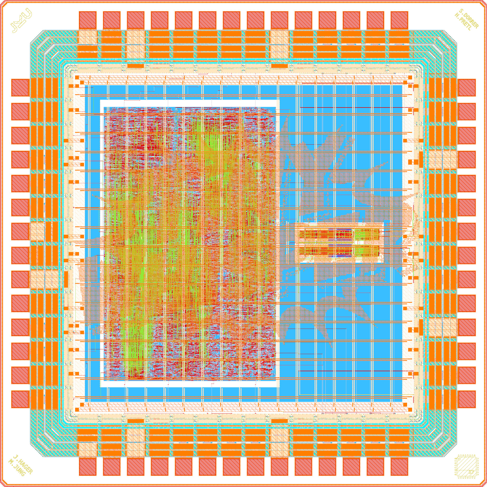
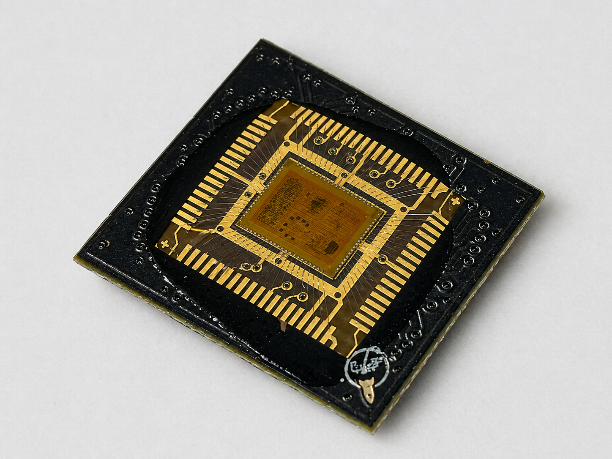
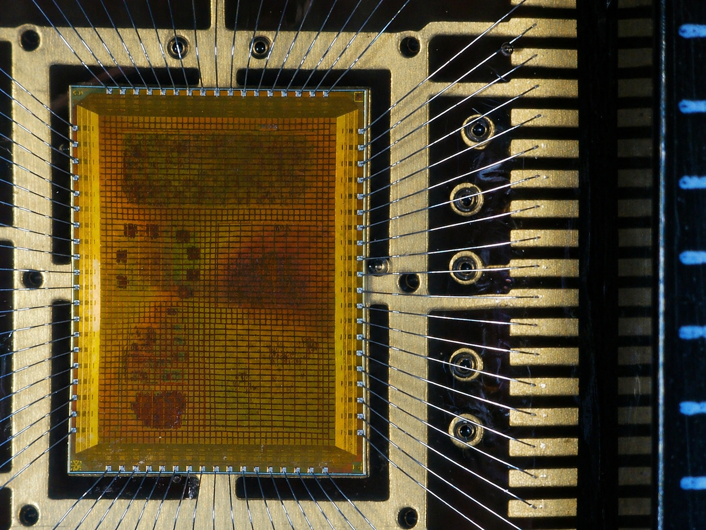

# Open-Source Chip Gallery

(c) 2025-2026 Simon Dorrer and contributors

Institute for Integrated Circuits and Quantum Computing (IICQC), Johannes Kepler University (JKU), Linz, Austria

> [!IMPORTANT]
> This repository requires the [IIC-OSIC-TOOLS](https://github.com/iic-jku/IIC-OSIC-TOOLS) container with tag `2026.08` or later.

This gallery collects the open-source chips that were designed and taped out at the IICQC at JKU Linz, some of them together with partners from other universities and schools. Every chip comes with its final layout, rendered images of the layout and a link to the repository with the full design data.

| Chip | Technology | Shuttle | Tapeout | Die Size | Directory |
| ---- | ---------- | ------- | ------- | -------- | --------- |
| [SPARX](#sparx-ihp-mpw-tapeout) | IHP SG13CMOS (130 nm) | IHP MPW | March 2026 | 1mm x 1.4mm | [`ihp-sg13cmos-sparx-mpw-2026-03`](ihp-sg13cmos-sparx-mpw-2026-03) |
| [TinyWhisper](#tinywhisper-ihp-mpw-tapeout) | IHP SG13CMOS (130 nm) | IHP MPW | March 2026 | 2mm x 2mm | [`ihp-sg13cmos-tinywhisper-mpw-2026-03`](ihp-sg13cmos-tinywhisper-mpw-2026-03) |
| [Multi-Project Chip](#multi-project-chip-waferspace) | GF180MCU (180 nm) | wafer.space run 1 | December 2025 | 4mm x 5mm | [`gf180mcuD-mpc-ws-run1`](gf180mcuD-mpc-ws-run1) |
| [IQ Modulator](#iq-modulator-tiny-tapeout) | SkyWater SKY130A (130 nm) | Tiny Tapeout ttsky25b | November 2025 | 334.88µm x 225.76µm | [`sky130A-iqmod-ttsky25b`](sky130A-iqmod-ttsky25b) |

The chips are listed with the most recent tapeout first. The designers of each chip are given in the order of its design repository, and they are from JKU unless another affiliation is noted. To add a new chip or to update an existing one, follow the steps in [CONTRIBUTING.md](CONTRIBUTING.md).

Every chip has its own directory with the final layout (GDS/OASIS) and the rendered layout images. All files carry the name of the directory they live in, so the layout is `<directory>_top` and the two renders are `<directory>_white.png` and `<directory>_black.png`. Further images, such as a pinout or photos of the fabricated die, are named `<directory>_<description>.png`. The original top cell names are kept inside the layout files.

The images are created with `sak-render.py` from [IIC-OSIC-TOOLS](https://github.com/iic-jku/IIC-OSIC-TOOLS), which draws the physical mask layers in the layer colors of the PDK and hides fill and dummy shapes. Every layout is rendered on both a white and a black background. The white version is shown below, unless the design repository provides a labeled pinout, as for SPARX. To re-render the images, run the following command in a chip directory inside the IIC-OSIC-TOOLS container:

```sh
sak-render.py -t <ihp-sg13g2|ihp-sg13cmos5l|gf180mcuD|sky130A> -w 2048 -s 4 -o <directory>.png <layout>
```

The SG13CMOS designs are rendered with the `ihp-sg13g2` layer colors because SG13CMOS and SG13G2 use the same layer stack.

The structure of this gallery is inspired by [mole99/chip-gallery](https://github.com/mole99/chip-gallery).

# SPARX (IHP MPW Tapeout)

An open-source, frequency-scalable six-port millimeter-wave receiver.

<div align="center">
  
  <p><em>Render of the 160 GHz ihp-sg13cmos SPARX RFIC with pinout (1mm x 1.4mm).</em></p>
</div>

SPARX ("Six-Port Automated Receiver (RX)") is a six-port receiver in IHP SG13CMOS (130 nm). The whole layout is generated in Python with custom RF devices built as a GDSFactory add-on for the IHP PDK. This way, the design can be scaled to any frequency between 60 GHz and 300 GHz without manual layout work. It was taped out in March 2026, on the same day as [TinyWhisper](#tinywhisper-ihp-mpw-tapeout).

The image above shows the default 160 GHz variant, which is kept as the top cell `sparx160_top` inside the layout. The LO enters on the left, passes the bandpass filter (BPF) and is split by the Wilkinson power divider (WPD) between the upper and the lower branch-line coupler (BLC). The RF enters on the right and is split by a third BLC, whose fourth port is terminated by R1. The upper and the lower BLC each drive two Schottky diode power detectors (PD). Every detector has an OUT pad and a REF pad from its replica circuit, so its output can be measured fully differentially.

For the measurements, the LO and RF pads will be contacted with a wafer prober, and the supply and detector pads at the top and bottom will be bonded to a PCB.

- Designers: Simon Dorrer, David Kellerer-Pirklbauer and Harald Pretl
- Technology: IHP SG13CMOS (130 nm)
- Die size: 1mm x 1.4mm
- Supply voltage: 1.5 V
- Scalable from 60 GHz to 300 GHz (default: 160 GHz)
- Building blocks:
  - Hairpin coupled-line bandpass filter (Butterworth, Chebyshev or elliptic)
  - Wilkinson power divider ("C" or "U" configuration)
  - Branch-line coupler (90° hybrid)
  - Schottky barrier diode (SBD) power detector with a replica circuit for fully differential measurements
- RF routing on TopMetal2, ground plane on Metal5

SPARX was designed at the IICQC at JKU Linz and is funded by the JKU/SAL Intelligent Wireless Systems Lab.

Repository: https://github.com/iic-jku/SG13CMOS_SPARX

# TinyWhisper (IHP MPW Tapeout)

A fully integrated multi-mode short-wave transmitter for amateur radio.

<div align="center">
  
  <p><em>Render of the ihp-sg13cmos TinyWhisper SoC (2mm x 2mm).</em></p>
</div>

TinyWhisper is a short-wave transmitter chip for the amateur radio bands that supports WSPR, FT8, SSB and CW. It combines a RISC-V based digital core with an analog IQ modulator on a single die. Besides ham radio use, the chip is meant for teaching in university courses and as a regression test case for open-source EDA tools. It was taped out in March 2026 and is currently in production. Delivery is expected in December 2026.

The image above shows the final layout with the TinyWhisper logo. The RISC-V core is the large block left of the center, and the analog IQ modulator is the small macro to the right of it.

- Designers: Simon Dorrer (OE3SDE), Jonathan Hager (DK7JH, JMU Würzburg), Matthias Jung (DL9MJ, JMU Würzburg) and Harald Pretl
- Technology: IHP SG13CMOS (130 nm)
- Die size: 2mm x 2mm
- Package: QFN-48
- Supply voltage: 1.5 V core, 3.3 V I/O
- Clock frequency: 56 MHz
- Digital core:
  - 32-bit RISC-V processor
  - 30-bit CORDIC for signal generation
  - Delta-Sigma modulator
  - GPIO, I²C and UART interfaces
- Analog front-end:
  - IQ modulator with passive CMOS mixers
  - 3rd-order low-pass filters (400 kHz cutoff)

TinyWhisper is a joint project of the IICQC at JKU Linz and Julius-Maximilians-Universität (JMU) Würzburg.

Repository: https://github.com/iic-jku/TinyWhisper (`ihp130`)

# Multi-Project Chip (wafer.space)

A shared die for student and research designs from JKU.

<div align="center">
  
  <p><em>Render of the gf180mcuD multi-project chip (4mm x 5mm).</em></p>
</div>

This multi-project chip collects designs from students and researchers at the IICQC at JKU Linz on a single die, with contributions from JMU Würzburg, HTL Leonding and the Linzer Technikum. It was submitted to the first [wafer.space](https://wafer.space/) shuttle in December 2025 using the gf180mcuD PDK. The chips have been delivered, and a first bring-up test on a wire-bonded die shows that the chip is alive.

<div align="center">
  
  &nbsp;
  
  <p><em>Chip-on-Board (CoB) wire-bonded die of the gf180mcuD multi-project chip (left) and a micrograph of the bonded die next to a ruler (right).</em></p>
</div>

- Designers: Simon Dorrer, Jonathan Hager (JMU Würzburg), Dominik Brandstetter and the project designers listed below
- Technology: GlobalFoundries GF180MCU (180 nm), gf180mcuD PDK variant
- Die size: 4mm x 5mm
- Implemented with [LibreLane](https://github.com/librelane/librelane) and [OpenROAD](https://github.com/The-OpenROAD-Project/OpenROAD)
- Projects on the chip:
  - Multiplexer (Simon Dorrer)
  - TinyWhisper RISC-V (Jonathan Hager, JMU Würzburg)
  - TinyTone (Jakob Schaumberger)
  - Decimation Filter (Michael Köfinger)
  - Octowave (Max Golser)
  - Tetris (Dominik Brandstetter and HTL Leonding)
  - TinyStack (Linzer Technikum)
  - TinyBF (Rene Hahn)
  - SAR ADC Controller (Ilir Shala)
  - LED Spinner (Tim Tremetsberger)
  - TinyToneGen (Felix Feierabend)
  - Digital Filter (Gregor Flachs)
  - Traffic Light Controller (Maximilian Kernmaier)
  - VGA Clock (Timo Laimer)

Repository: https://github.com/iic-jku/gf180mcu-jku-projects

# IQ Modulator (Tiny Tapeout)

The analog front-end of the TinyWhisper transmitter on its own tile.

<div align="center">
  
  <p><em>Render of the sky130A TinyWhisper IQ modulator (334.88µm x 225.76µm).</em></p>
</div>

This is the first design of the IQ modulator that forms the analog front-end of the [TinyWhisper SoC](#tinywhisper-ihp-mpw-tapeout). It was submitted to the [Tiny Tapeout ttsky25b](https://tinytapeout.com/chips/ttsky25b/tt_um_TinyWhisper) shuttle in November 2025 to prove the block on silicon before it became part of a full chip. An improved version is included in the IHP tapeout.

The modulator takes differential baseband I and Q signals, filters them with 3rd-order MFB low-pass filters and upconverts them with passive mixers that are driven by the four local oscillator phases. The two paths are summed at the RF output of the transmitter.

- Designers: Simon Dorrer (OE3SDE) and Harald Pretl
- Technology: SkyWater SKY130A (130 nm)
- Die size: 334.88µm x 225.76µm (2x2 Tiny Tapeout tiles)
- Supply voltage: 1.8 V
- 3rd-order MFB low-pass filter with an inverter-based OTA core
- Passive CMOS mixers driven by the four LO phases
- Five analog pins: the RF output and the differential I and Q inputs
- Enable input for the analog front-end
- Schematics and simulation with Xschem and Ngspice, layout drawn in Magic

Repositories: https://github.com/iic-jku/tt-sky-jku-jmu-TinyWhisper and https://github.com/iic-jku/TinyWhisper (`sky130`)

# License

This repository is licensed under the [Apache License 2.0](LICENSE) unless noted otherwise. The chip layouts and the images taken from the design repositories, such as pinouts and chip photos, keep the licenses of the design repositories that are linked in each chip section.
